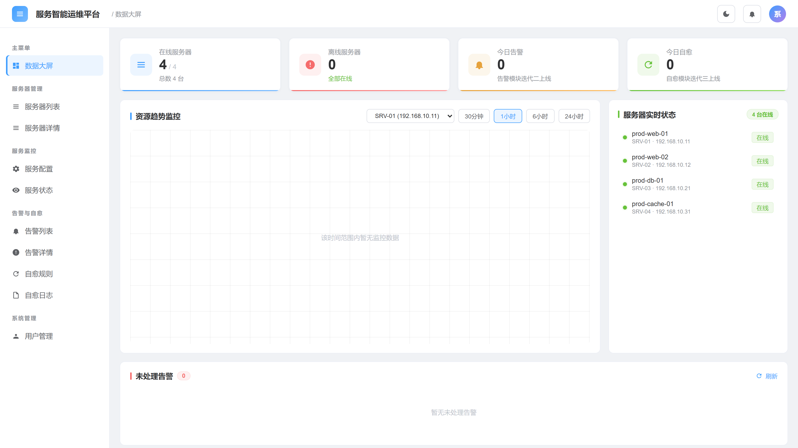
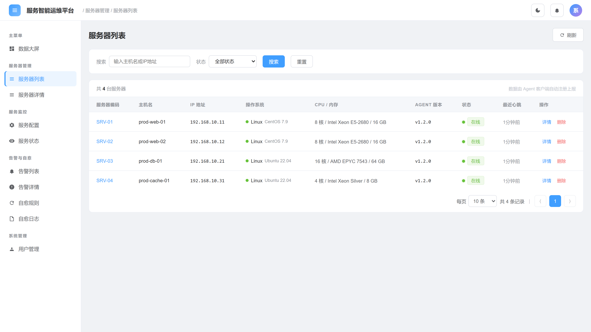
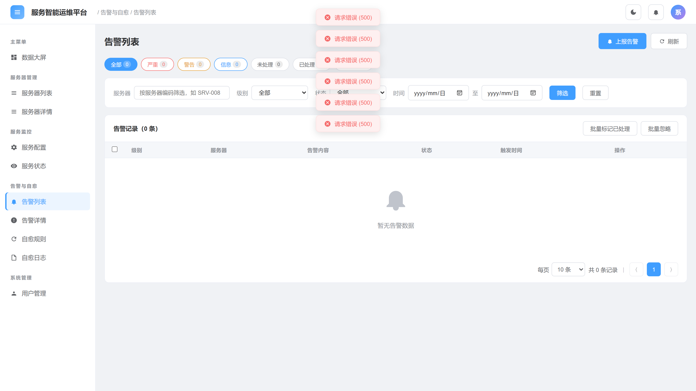
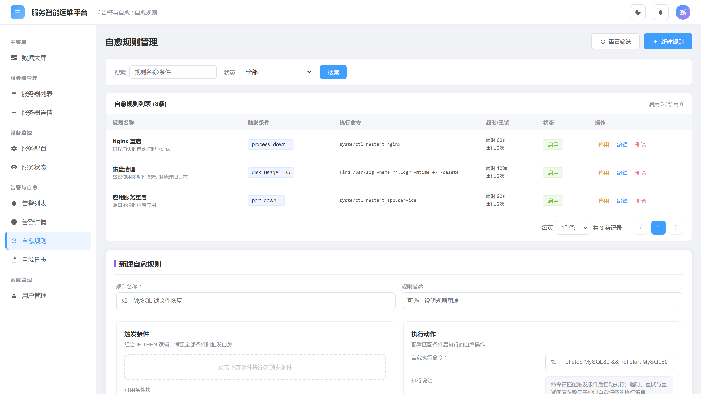
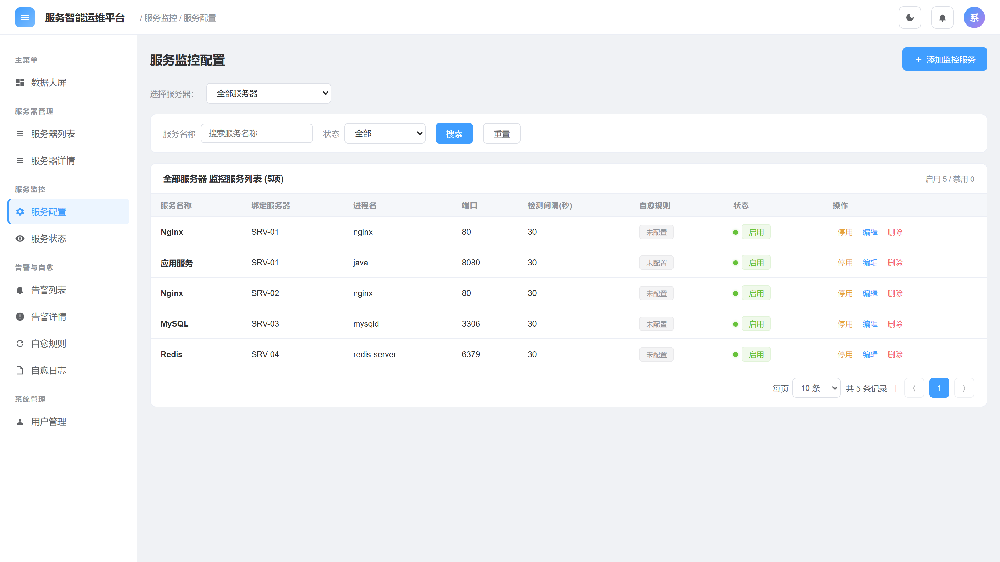
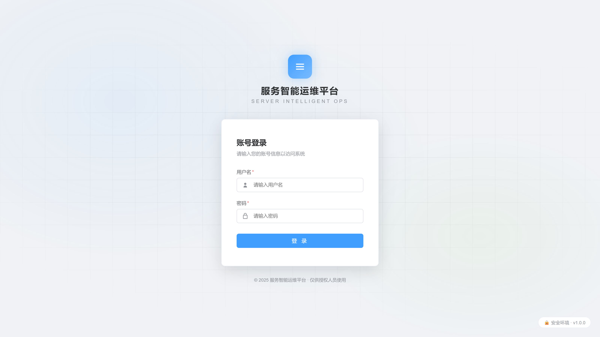
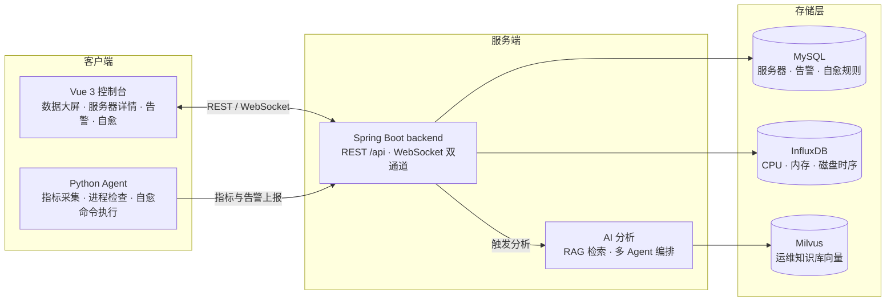

# ServerOps 服务器智能运维平台

ServerOps（服务器智能运维平台）是一套面向主机资产、状态监控、告警通知与自愈处置的一体化运维方案，采用**前后端分离**架构：

- **backend/**（Java 17 · Spring Boot 3）—— REST API、鉴权、WebSocket 实时推送、时序指标存储、邮件通知、AI 告警分析。
- **frontend/**（Vue 3 · Vite）—— 数据大屏、服务器管理、服务监控、告警与自愈、用户管理等 Web 控制台。
- **client/**（Python 3.11+）—— 部署在被监控主机上的监控客户端（Agent），采集指标并上报、上报告警、执行自愈命令。

## 界面预览

<p>
  
  
</p>
<p>
  
  
</p>
<p>
  
</p>

<details>
<summary>登录页</summary>



</details>

## 系统结构




整体数据流：`client(Agent) 采集 → 上报告警/指标 → backend 落库并推送 → frontend 展示 & 触发告警/自愈/邮件通知/AI 分析`。

---

## 功能特性

### 服务器管理
- 服务器资产列表、详情与实时指标（CPU / 内存 / 网络 / 磁盘 IO / 磁盘空间）。
- 通过 WebSocket 向前端实时推送指标，折线图实时刷新；支持指标回放与对比。

### 实时监控与数据大屏
- Dashboard 数据大屏汇总服务器数量、在线状态、告警总数等关键信息。

### 服务监控
- 服务配置与运行状态管理：客户端按服务端下发的配置检查进程与 TCP 端口。
- Agent 检测到服务异常时上报告警，并支持**服务状态**实时上报。

### 告警通知
- 告警事件统一管理（列表 + 详情）。
- 邮件告警通知：SMTP 发送 + 失败重试，记录通知日志并在前端铃铛面板展示。

### 智能自愈（healing）
- 为每项服务绑定**自愈规则**：匹配指标 / 进程 / 端口 / 日志正则等触发条件。
- 规则配置了执行超时与重试参数，Agent 匹配后执行命令并上报**自愈日志**。
- 命令执行期间持续复采指标，触发条件恢复即提前判定成功，最终超时后复检。

### AI 告警分析（agent 模块）
- 对告警执行**根因分析**，生成原因 / 建议 / 思维链，支持用户反馈（准确 / 不准确 / 部分准确）。
- 基于 **RAG** 增强：告警文本向量化后检索历史相似告警，注入 prompt 后交给本地大模型分析，向量语料「边分析边长」。
- 分析结果落库 `ai_analysis_result`，每告警仅分析一次（幂等）。

### 系统与安全
- JWT 认证与鉴权，基于角色的用户管理（管理员 / 普通用户）。
- dev 环境可配置 `permit-all=true` 免登录调试。

---

## 目录结构

```
ServerOps/
├── backend/            # Java 17 / Spring Boot 3 后端（Maven）
│   └── src/main/java/com/qingruan/
│       ├── agent/      # 告警 AI 分析（本地 LLM + 向量检索）
│       ├── common/     # 配置 / 常量 / 结果封装 / 安全
│       ├── controller/ # REST 接口层
│       ├── entity|dto|vo/
│       ├── mapper/     # MyBatis-Plus 数据访问
│       ├── service/    # 业务逻辑
│       └── websocket/  # 与 frontend / client 的实时通道
├── frontend/           # Vue 3 / Vite 前端（npm）
│   └── src/views/      # dashboard / server / service / alert / healing / user
├── client/             # Python 监控客户端（Agent）
│   └── serverops_client/   # 采集 / 上报 / 配置 / 缓存重试 / 自愈 / UI 独立模块
├── docs/               # 接口文档（OpenAPI）
├── scripts/            # 辅助脚本
└── start_*.bat         # Windows 一键启动脚本
```

---

## 技术栈

| 模块 | 技术 | 说明 |
|------|------|------|
| 后端 | Java 17 / Spring Boot 3.3.5 | 基础框架 |
| 后端 | MyBatis-Plus 3.5.7 | 数据访问（适配 Spring Boot 3） |
| 后端 | Spring Security + JWT (JJWT 0.12.6) | 认证鉴权 |
| 后端 | MySQL 8 / Redis / InfluxDB | 业务数据 / 缓存 / 时序指标 |
| 后端 | WebSocket | 前后端、客户端实时推送 |
| 后端 | Spring Mail | 告警邮件通知 |
| 后端 | Swagger v3 (Jakarta) | OpenAPI 文档 |
| 前端 | Vue 3 / Vite / Pinia / vue-router | 单页应用 |
| 客户端 | Python 3.11+ / psutil / httpx / websockets / PySide6 | 指标采集与桌面 UI |
| AI | llama.cpp + Chroma（或 DeepSeek 云端 API） | 告警根因分析与 RAG |

---

## 快速开始

### 0. 环境要求
- JDK 17+、Maven 3.9+
- Node.js `^22.18.0 || >=24.12.0`
- MySQL 8、Redis、InfluxDB
- Python 3.11+
- （可选）AI 分析依赖的本地模型服务，见[后端 AI 模块](#ai-告警分析部署的-3-个服务)

### 1. 后端（backend）

首先需要完善yml配置，新建在`src/resources/`中新建`application-dev.yml`,编写如下配置:

```yml
spring:
  datasource:
    url: 
    username: 
    password: 

  data:
    redis:
      host: 
      port: 

  mail:
    host: smtp.qq.com              # SMTP 服务器地址
    port: 465                      # 端口（SSL=465 / STARTTLS=587）
    username:     				   # 发件人邮箱账号
    password:    				   # SMTP 授权码（非邮箱登录密码，需在邮箱后台开启SMTP服务后获取）

security:
  permit-all: true				   # 跳过鉴权

influxdb:
  url: 
  token: 

ai:
  analysis:
    ollama:
      api-key: 
    embedding:
      api-key: 
    vector:
      chroma:
        base-url:
        collection:
```

然后运行

```powershell
cd backend
mvn spring-boot:run
# 或直接运行 ServerOpsApplication
```
> 应用默认上下文路径 `/api/v1`，端口 `8080`。数据库 / Redis / InfluxDB 连接等配置见
> `backend/src/main/resources/application.yml`，本地差异放 `application-dev.yml`（不提交密钥）。

如需部署,构建命令如下:

```
mvn clean package
```

可以在`target`中找到打包的`.jar`文件

### 2. 前端（frontend）
```powershell
cd frontend
npm ci
npm run dev
# 开发服务器默认 http://localhost:5173
```
> 后端接口地址在 `frontend/.env.example` 中通过 `VITE_API_TARGET` 配置（默认 `http://localhost:8080`）。

如需部署,打包构建命令如下:

```
npm run build
```

可以输出目录在`dist`

### 3. 客户端（client）
```powershell
cd client
py -3 -m venv .venv
.\.venv\Scripts\Activate.ps1
python -m pip install -e ".[dev]"
serverops-client
```
> 首次启动进入「设置」填写服务器地址与 `X-Agent-Token`；也可用环境变量配置，详见
> [`client/README.md`](client/README.md)。客户端最低要求 Python 3.11，完整约定见该文档。

### 4. 一键启动（Windows）
在项目根目录运行 `start_all.bat` 可同时拉起前端、客户端与后端三个窗口。

---

## 部署前提：AI 告警分析（agent）模块的 3 个服务

后端 `com.qingruan.agent` 模块的「告警 AI 分析」依赖 **1 个常驻服务**（均跑在你本机/内网，无 Docker 也行）。
与后端通过 HTTP 通信，**不需要改 pom 依赖**。

| 服务 | 端口 | 作用 | 模型 |
|------|------|------|------|
| Chroma | 8000 | 向量存储 + 相似度检索 | — |

### Chroma 向量库（端口 8002）

```powershell
pip install chromadb
# 启动 HTTP 服务（--path 指定持久化目录，重启不丢数据）
chromadb run --path ./chroma_data --port 8002
```

- 端点：`http://127.0.0.1:8000`（后端通过 `/api/v2/...` 调用）
- 后端 `application.yml`：`ai.analysis.vector.chroma.base-url=http://127.0.0.1:8000`，`collection=serverops_alert_analysis`

> Chroma 是纯 Python 服务，后端用 `RestTemplate` 走 HTTP 调用，**无需在 pom 里加任何依赖**。
> 集合在首次写入时自动创建（余弦距离 `cosine`）。

### 4) 历史告警回填（可选，初始化语料）

向量库是「边分析边长」的：每次 `analyze` 成功会自动把该告警写进 Chroma。
但**分析之前就存在的告警**从没进过向量库，需要手动灌一次，否则新告警检索不到历史经验。

Chroma 起好后，调一次后端回填接口（dev 环境免登录）：

```powershell
curl.exe -X POST http://localhost:8080/api/v1/ai-analysis/index/backfill
# 返回 {"code":0,"message":"success","data": <成功条数>}
```

- Chroma 不可达时返回 `0` 且不报错。
- 相同 `alertId` 会覆盖，可重复跑（幂等）。

### 5) 验证顺序

1. Chroma：`curl.exe http://127.0.0.1:8000/api/v2/heartbeat`
2. 启动 Spring Boot 后端，再调 `POST /ai-analysis/alerts/{alertId}/analyze` 即可触发带 RAG 的分析。

> 任何一项不可用时，`analyze` 主流程仍可正常返回（只是没有向量检索上下文），不会 500。

---

## AI 分析接口一览

| 方法 | 路径 | 说明 |
|------|------|------|
| GET  | `/api/v1/ai-analysis/alerts/{alertId}` | 获取当前告警的 AI 分析结果（单条或 null） |
| POST | `/api/v1/ai-analysis/alerts/{alertId}/analyze` | 幂等触发分析（首次调 LLM，再次直接返回已有；每告警仅一次） |
| POST | `/api/v1/ai-analysis/{id}/feedback` | 回写用户反馈（ACCURATE / INACCURATE / PARTIAL） |
| POST | `/api/v1/ai-analysis/index/backfill` | 历史告警向量回填（一次性） |

分析流程（含 RAG）：

```
POST /alerts/{alertId}/analyze
 ├─ 幂等：已分析过 → 直接返回
 ├─ 查 alert_event（无 → 404）
 ├─ embed(告警文本) → 向量
 ├─ Chroma 检索 Top-K 相似历史告警（排除自身）
 ├─ 相似案例注入 prompt → 交给大模型分析
 ├─ 落库 ai_analysis_result
 └─ 把本条索引进 Chroma（语料自增长）
```

---

## 客户端上报 / 接口约定

完整 OpenAPI 定义见 [`docs/默认模块.openapi.yaml`](docs/默认模块.openapi.yaml)，常用接口：

- `POST /api/v1/servers/register` / `POST /api/v1/servers/heartbeat` —— Agent 注册与心跳
- `POST /api/v1/metrics` / `GET /api/v1/metrics/query` —— Agent 上报指标、查询时序指标
- `GET /api/v1/servers` / `GET /api/v1/servers/{id}` —— 查询服务器
- `GET /api/v1/dashboard/summary` —— 数据大屏汇总
- `POST /api/v1/alert-events` —— Agent 上报告警
- `POST /api/v1/agent/service-status/report` —— Agent 上报服务状态
- `POST /api/v1/healing-action-logs` —— Agent 上报自愈执行日志
- `GET/POST /api/v1/healing-rules`、`/api/v1/service-healing-bindings` —— 自愈规则管理
- `/api/v1/auth/login|logout`、`/api/v1/users` —— 认证与用户管理

> 客户端 Agent 的详细采集、缓存重试、告警冷却、自愈执行与 WebSocket 约定见
> [`client/README.md`](client/README.md)。

---

## 测试

```powershell
# 后端
cd backend && mvn test

# 前端
cd frontend && npm run build

# 客户端（Python）
cd client && python -m pytest
cd client && python -m ruff check .
```

---

## 重要网络安全说明

- 密钥、Token、数据库口令与服务器地址只能通过环境变量或**未跟踪的本地配置**（如 `application-dev.yml`、`client/.env.example`）提供，**不要提交到仓库**。
- 本仓库 `.gitignore` 已排除 `target/`、`node_modules/`、`.venv/`、`dist/` 等生成与依赖目录。
- Agent 与后端之间使用静态 Token（`agent.token`）通信，请在生产环境改为安全密钥。

---

## 常用命令速查

| 操作 | 命令 |
|------|------|
| 后端运行 | `cd backend && mvn spring-boot:run` |
| 后端测试 | `cd backend && mvn test` |
| 前端安装 | `cd frontend && npm ci` |
| 前端开发 | `cd frontend && npm run dev` |
| 前端构建 | `cd frontend && npm run build` |
| 客户端安装 | `cd client && py -3 -m venv .venv && pip install -e ".[dev]"` |
| 客户端启动 | `cd client && serverops-client` |
| Python 测试 | `cd client && python -m pytest` |

---

本项目为团队协作开发，此仓库为个人整理版本，用于作品展示。
